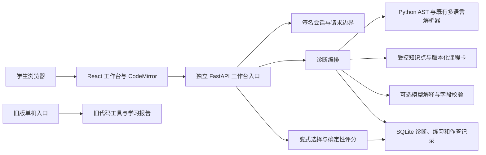
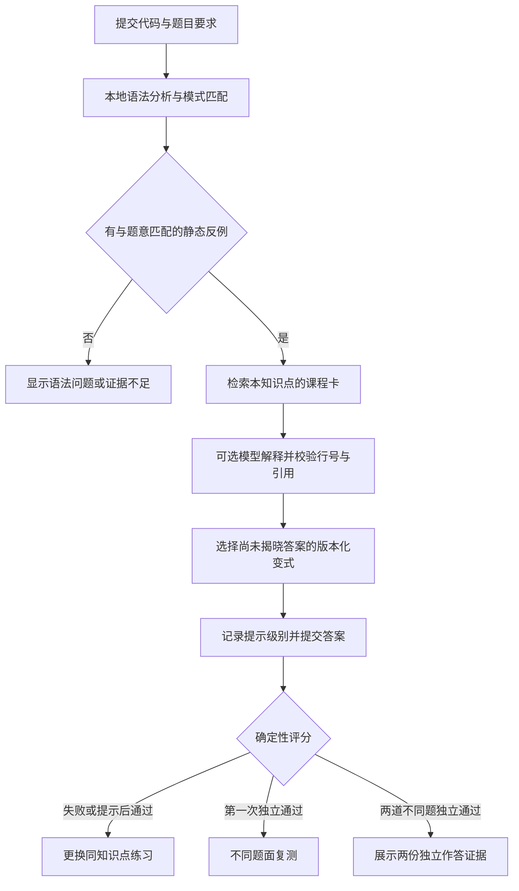

# 架构与教学工作流

## 系统架构

旧本地工具由单独应用启动。新版服务不挂载旧文件管理、旧身份接口或兼容接口。部署使用专用数据库。模型只收到标准示例、可信证据与尝试计数。学生代码不执行，原始提交也不发送给模型。

## 教学工作流

分析事件只描述服务实际完成的步骤。诊断和作答采用不同的幂等键。作答更新和尝试记录共享同一事务。既有题目版本仍可判分，已看到答案的模板不会增加独立通过次数。
